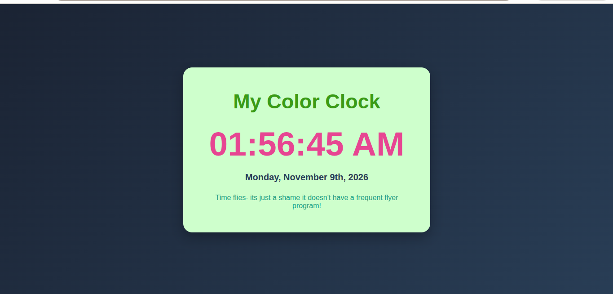

# Dynamic Color Clock

## Project Description

The Dynamic Color Clock is a simple digital clock application built using React and Vite.

It displays the current date and time and automatically updates every second.

## Technologies Used

1 React
2 JavaScript
3 Vite
4 npm
5 date-fns
6 HTML
7 CSS

## Features

- Displays the current time in hours, minutes, and seconds.
- Displays the current date.
- Automatically updates every second.
- Uses date-fns for date and time formatting.
- Attractive and colorful user interface.

## Installation Instructions

1. Clone this repository:

   git clone YOUR_GITHUB_REPOSITORY_URL

2. Navigate into the project folder:

   cd color-clock

3. Install dependencies:

   npm install

4. Start the development server:

   npm run dev

5. Open the local URL displayed in your terminal.

## Application Screenshot

## Author

Antony

## Purpose

This project/lab was put together as part of a React and npm learning assesment.
